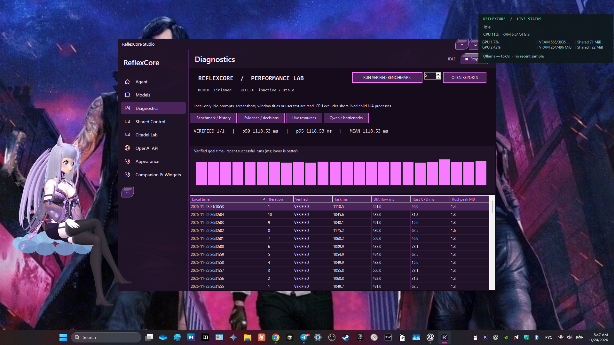
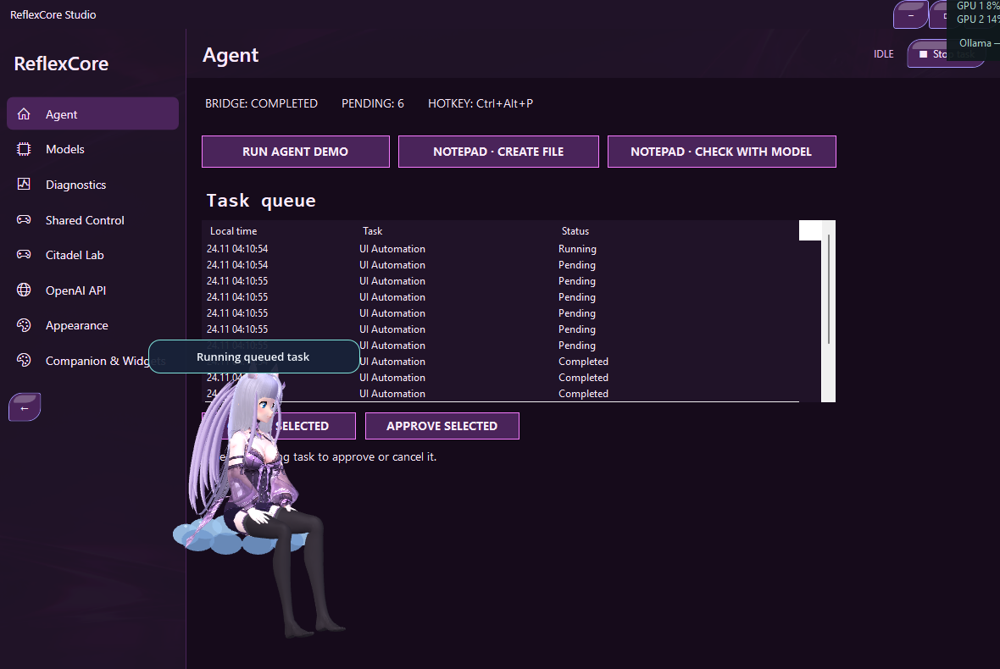
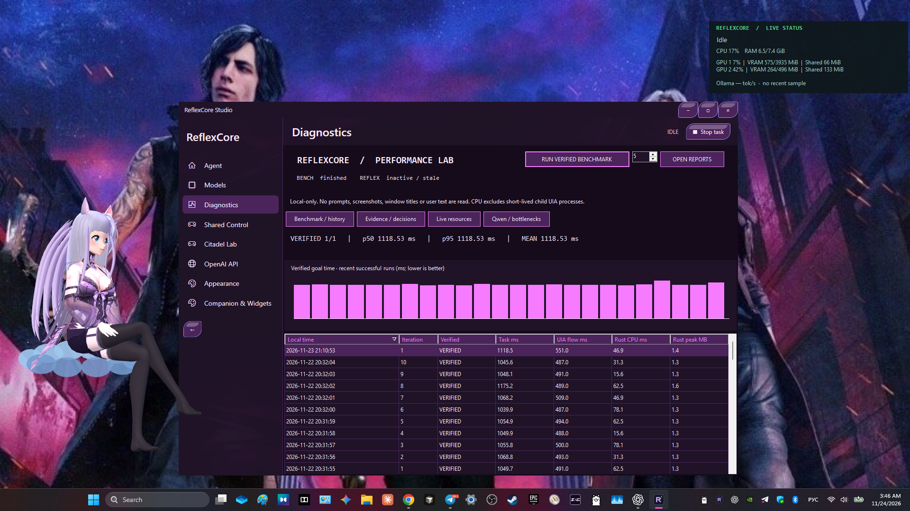
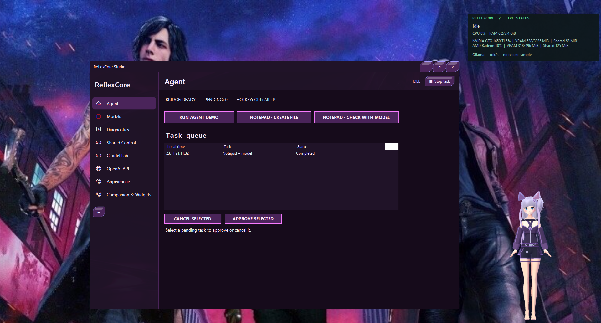
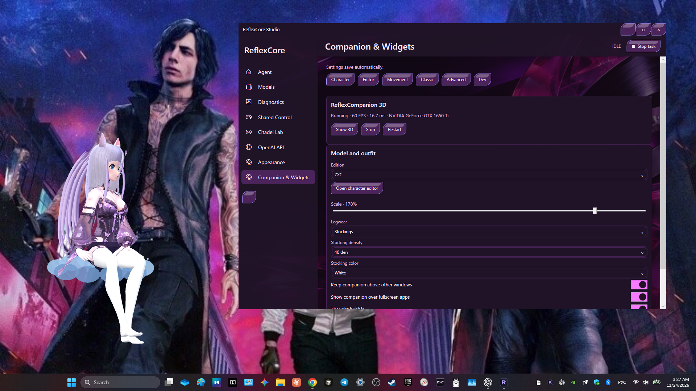
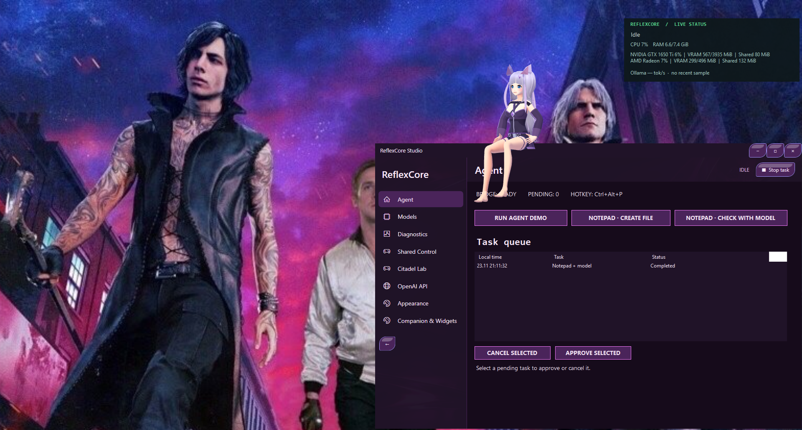

# ReflexCore Engine

**[Download Portable (Windows x64)](https://github.com/triple6xseven/ReflexCore/releases/download/v0.7.1-alpha.2-windows.1/ReflexCore-Portable-win-x64.zip)** | [Download Setup](https://github.com/triple6xseven/ReflexCore/releases/download/v0.7.1-alpha.2-windows.1/ReflexCore-Setup-win-x64.exe) | [Installation guide](docs/WINDOWS-DOWNLOADS.md)

Local-first Windows automation for PCs with limited RAM and GPU capacity. ReflexCore uses a Rust planner and native Windows UI Automation to execute supported tasks, check their results and reuse successful methods. Ollama is optional for tasks that need visual input.

**Status: early alpha.** Today, ReflexCore runs a small set of verified desktop tasks. General desktop automation and autonomous gameplay are still in development.

## What works today

**Play CS 1.6 with ReflexCore.** Open **Play with a teammate → Start local server**, then join through **Find Servers → LAN**. Press **H** for Follow, Hold, FreeRoam AI or a first-person spectator camera in a second client. FreeRoam uses a route derived from the installed Dust II map. The local actor uses server visibility and team information to aim. In an observed offline Dust II round, the server logged an AK-47 kill by ReflexCore and a Terrorist team win. Press J to change YaPB opponent difficulty. Player candidates appear only in the ReflexVision preview. Match win rate and visual-only play remain unmeasured. [Lobby guide](docs/CS16-LOCAL-TEAM.md)

- **F9 autopilot** is available in the local-lobby development branch. Press F9 to let Reflex play your character, then press it again to resume control. [Local lobby controls](https://github.com/triple6xseven/ReflexCore/blob/feat/local-teammate-lobby/docs/CS16-LOCAL-TEAM.md)

- **Plan, act and verify.** The built-in Windows UI Automation scenario runs a sequence of actions and checks the resulting state. The Notepad skill creates a new file and verifies its contents from disk.
- **Reuse successful methods.** The Notepad skill verified 20 of 20 files in a local Windows test, with zero model calls. Median execution time was 746 ms after the supervisor started. See [benchmark methodology](docs/BENCHMARKS.md).
- **Supervise tasks in Studio.** Submit built-in tasks, cancel pending work and inspect a local task history. See [Studio](docs/STUDIO.md) and [queue recovery](docs/QUEUE.md).
- **Inspect live game vision.** ReflexVision displays tracked visual cues and HUD boxes alongside a windowed offline match. See [ReflexVision](docs/REFLEXVISION.md).

**[GitHub Support](https://github.com/sponsors/triple6xseven)**

## Studio & Companion preview

Screenshots from the [3D companion development branch](https://github.com/triple6xseven/ReflexCore/tree/feat/companion3d).

## What we are building next

Expand the verified skill catalog and measure reliability on real tasks. The offline CS 1.6 controller navigates and plants C4 on the original practice map in an isolated GoldSrc server. Game logs score the result. The project can also calculate routes through Dust II. Live completion on Dust II and a win against an active opponent remain future milestones. See the [game benchmark](docs/CS16-BENCHMARK.md).

## Build from source

On Windows 11, use the Rust MSVC toolchain, Visual C++ Build Tools, the .NET 8 SDK, the .NET Framework 4.8 targeting pack and Windows PowerShell 5.1.

~~~powershell
cargo build --release --locked
dotnet build .\ui\ReflexCore.Studio.csproj -c Release
powershell.exe -NoProfile -File .\tools\Start-ReflexCore.ps1
~~~

In Studio, open **Agent** and select **NOTEPAD · CREATE FILE** to try the new-file task. Keep the new Notepad window in the foreground.

Start with the [runtime architecture](docs/COGNITIVE-RUNTIME.md), [changelog](CHANGELOG.md), or [contributor notes](AGENTS.md). ReflexCore is [MIT-licensed](LICENSE).

## Attribution

When redistributing copies or modified versions, retain the MIT copyright and permission notice, including the author link to [triple6xseven](https://github.com/triple6xseven).
